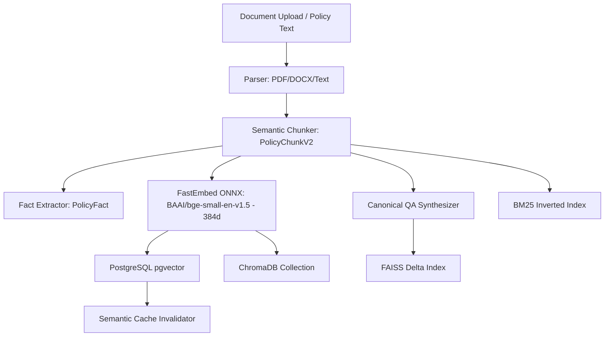
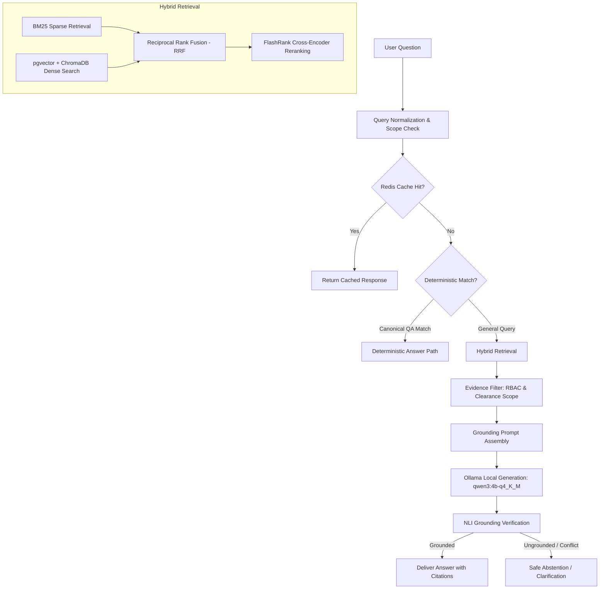

# VERITAS — Comprehensive System Architecture and Implemented Methodology

## 1. System Overview and Core Design Principles

Veritas is a local, version-aware, evidence-grounded Retrieval-Augmented Generation (RAG) platform designed for organizational policy governance, compliance tracking, and deterministic question answering.

The platform is strictly engineered to run locally without external cloud dependencies:
- **Local Generation Model**: `qwen3:4b-q4_K_M` running via local Ollama.
- **Local Embedding Model**: `BAAI/bge-small-en-v1.5` via FastEmbed/ONNX producing 384-dimensional dense vectors.
- **Relational & Vector Storage**: PostgreSQL 16 with the `pgvector` extension, accompanied by persistent ChromaDB collections.
- **Caching & Broker**: Redis 7.2 providing distributed locking, Celery task queuing, and multi-tier semantic caching.
- **Worker Infrastructure**: Celery 5.3 asynchronous worker execution for document compilation and index synchronization.

---

## 2. Ingestion, Compilation, and Indexing Methodology

### 2.1 Parsing and Normalization
- Files uploaded via `/admin/policies/extract-file` are processed through `rag/parser/pdf_parser.py` into a standardized `ParserResult` object containing clean text, page numbers, and structural headings.
- Raw text is normalized to uniform UTF-8 encoding, stripping spurious control characters while preserving list structures, table layouts, and section headings.

### 2.2 Semantic Chunking (`PolicyChunkV2`)
- Policies are chunked into coherent semantic segments with configurable token windows (typically 250–500 tokens) with overlap.
- Each chunk preserves metadata linkages: `policy_id`, `version_id`, `section_heading`, and `confidentiality` level.

### 2.3 Dual Dense & Sparse Indexing
- **Dense Vectors**: Every chunk is embedded into 384 dimensions using FastEmbed (`BAAI/bge-small-en-v1.5`). Vectors are normalized and written simultaneously to:
  1. PostgreSQL `policy_chunk_v2.embedding` column with an `hnsw` index (`vector_cosine_ops`).
  2. Persistent ChromaDB collection (`data/chroma/`).
- **Sparse BM25**: Chunks are indexed into a persistent BM25 ranker (`data/bm25_index.pkl`) with language-specific tokenization and stopword management.
- **Canonical QA**: Precomputed question-answer pairs (`CanonicalQuestion`) are compiled into a FAISS index (`data/canonical_qa_faiss.index`) to allow sub-10ms deterministic retrieval for standard queries.

---

## 3. Query Execution and Retrieval Pipeline

### 3.1 Caching Tier
- Query strings are normalized (case folding, whitespace trimming).
- Exact match queries are checked against Redis (`Config.REDIS_URL`).
- Semantic caching calculates cosine similarity against recent query embeddings; queries exceeding `Config.SEMANTIC_CACHE_THRESHOLD` (0.85) reuse validated responses if the underlying policy versions have not drifted.

### 3.2 Hybrid Search and Fusion
- Queries are executed concurrently against BM25 (sparse term matching) and pgvector/Chroma (dense semantic matching).
- Candidate passages are fused using Reciprocal Rank Fusion (RRF):
  $$RRF(d) = \sum_{m \in \{dense, sparse\}} \frac{1}{k + \text{rank}_m(d)}$$
  where $k = 60$.

### 3.3 Cross-Encoder Reranking
- The top-20 fused candidates are passed to FlashRank ONNX (`ms-marco-TinyBERT-L-2-v2`) to compute fine-grained relevance cross-attention scores.
- Candidates falling below the minimum relevance threshold are discarded.

### 3.4 Security & Clearance Scoping
- The `EvidenceFilter` evaluates candidate chunks against the requesting user's identity:
  - Confidentiality checks (`INTERNAL`, `CONFIDENTIAL`, `RESTRICTED`).
  - Department scoping (confidential policies restricted to user's assigned department or Admin/HR).
  - Version temporal validity (`as_of` timestamp matching active versions).
- Any candidate failing authorization is completely excluded prior to LLM prompt assembly, preventing data leakage.

### 3.5 Generation, Grounding Verification, and Abstention
- The prompt is assembled with strict grounding instructions:
  - System prompt instructs the model to answer exclusively from the provided context chunks.
  - Model generates response with explicit citation references.
- An entailment verification pass checks that factual assertions in the generated response are entailed by the supplied context.
- If the evidence is insufficient, ambiguous, or contradictory, the system executes safe abstention:
  > *"I couldn't find this information in the available active policy documents."*

---

## 4. Discovered Deviations & Architectural Reconciliation

1. **LM Studio Deprecation**: Earlier development iterations contained an `LMStudioProvider` with external gateway mappings (`host.docker.internal:1234`). In this audit, this path was completely excised, formalizing Ollama as the sole supported local LLM backend.
2. **ChromaDB Rust Driver Segfault**: The default ChromaDB Rust client panicked when encountering nested `$eq` metadata filters. The retrieval driver was patched to use flat scalar dictionary filters.
3. **Dashboard Compliance Metrics**: The BI and Compliance dashboards previously evaluated acknowledgements across all policies without joining active employee filters. This resulted in impossible metrics (>100%). Full SQL `JOIN` constraints and mathematical upper-bounds were implemented.
