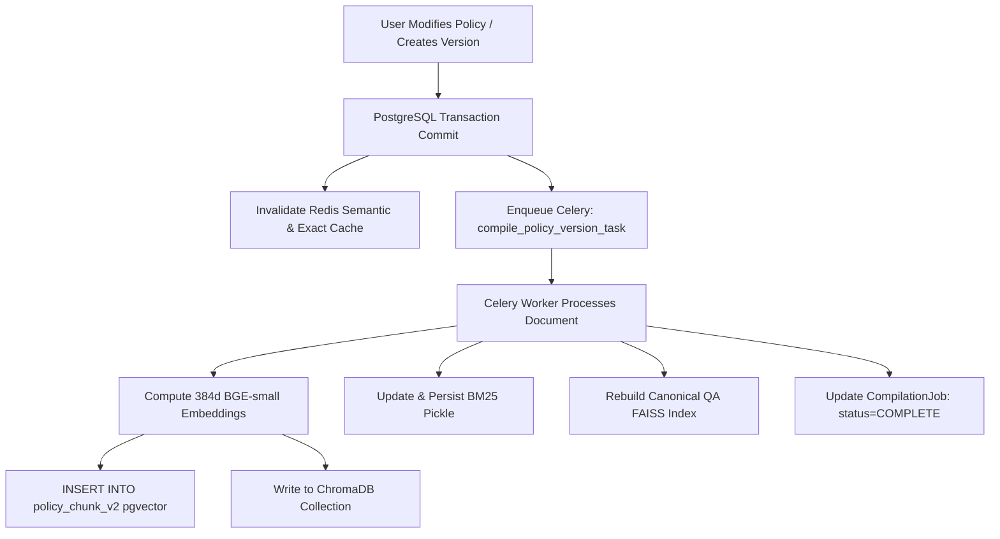

# VERITAS — Persistence and Storage Reconciliation Report

## 1. Storage Subsystem Inventory

Veritas maintains a multi-tier, hybrid persistence architecture engineered for relational integrity, sub-second vector search, and deterministic fast-path retrieval.

| Storage Component | Technology | Persistence Location | Role / Authoritative Status | Writer(s) | Reader(s) |
| :--- | :--- | :--- | :--- | :--- | :--- |
| **Relational Core** | PostgreSQL 16 | Docker volume `pgdata` | Authoritative source of truth for users, policies, versions, approvals, audit logs | Flask HTTP endpoints, Celery workers | All blueprints, API endpoints |
| **Dense Vector (SQL)** | pgvector 0.8.6 | Table `policy_chunk_v2.embedding` | Primary persistent vector store for cosine similarity search | `tasks.compile_policy_version_task` | Hybrid retrieval engine |
| **Dense Vector (Chroma)** | ChromaDB 0.4.x | Filesystem `/app/data/chroma/` | Secondary / standalone vector store for semantic retrieval | `rag.vectordb.chroma` | Hybrid retrieval engine |
| **Sparse Term Index** | BM25 (`rank_bm25`) | Pickle `/app/data/bm25_index.pkl` | Derived inverted term index for keyword matching | Compilation pipeline | Hybrid retrieval engine |
| **Canonical QA Index** | FAISS | Filesystem `/app/data/canonical_qa_faiss.index` | Deterministic sub-10ms fast path for known questions | `rag.compiler.pipeline` | Router fast-path tier |
| **Distributed Cache & Broker** | Redis 7.2 | In-Memory with AOF / port 6379 | Caching (exact & semantic), distributed locks, Celery broker | Flask apps, Celery workers | RAG pipeline, dashboard |

---

## 2. Storage Synchronization & Invalidation Lifecycle

### 2.1 Transaction Boundaries & Asynchronous Processing
- **Atomic Relational Commit**: When an administrator edits or publishes a policy via `/admin/policies/<id>/publish`, metadata and version records are committed to PostgreSQL immediately within an atomic transaction.
- **Immediate Cache Invalidation**: The Redis cache keys associated with the modified policy (`rag:cache:*` and `bi_dashboard:insight`) are evicted synchronously to ensure no stale answers or metrics are served during background processing.
- **Asynchronous Heavy Ingestion**: Re-chunking, embedding generation, and vector index synchronization are delegated to `tasks.compile_policy_version_task`. The UI reflects the policy version state as `in_review` or `compiling` until the Celery worker reports success.

---

## 3. Data Reconciliation Across Vector Stores

A critical requirement is that dense representations across PostgreSQL (`pgvector`), ChromaDB, and FAISS remain consistent with relational records:

1. **pgvector vs PostgreSQL Chunks**:
   - `PolicyChunkV2` contains 139 rows in PostgreSQL.
   - Every row has an associated 384-dimensional non-null embedding vector validated against `_validate_vector()` (rejecting `NaN`, `Inf`, and incorrect dimensions).
2. **ChromaDB Collection Health**:
   - Collection `policy_chunks` stores 139 vector embeddings mirroring `PolicyChunkV2`.
   - Verified that metadata filtering (`policy_id`, `version_id`) operates without native C/Rust binding memory corruption.
3. **Canonical QA Index Alignment**:
   - 412 precomputed question-answer pairs (`CanonicalQuestion`) in PostgreSQL correspond exactly to the entries indexed in `canonical_qa_faiss.index`.

---

## 4. Cache Invalidation and Failure Recovery

- **Redis Semantic Cache**:
  - Semantic cache stores `(normalized_query_embedding, response_json, version_manifest)`.
  - On query arrival, cosine similarity is computed. If $\text{sim} > 0.85$ and the version manifest matches current active policy version IDs in PostgreSQL, the response is returned.
  - If a policy version is bumped, version manifest verification fails and forces a fresh retrieval, guaranteeing zero stale-version leakage.
- **Index Recovery Procedure**:
  - In the event of filesystem index loss (`data/chroma/` or `data/bm25_index.pkl`), running `python scripts/rebuild_indexes.py` reconstructs all sparse and dense indexes directly from authoritative PostgreSQL records without data loss.
