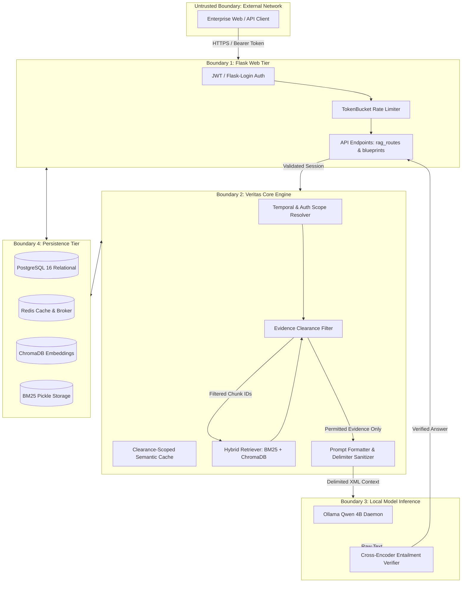

# REPORT I: SECURITY & TRUST BOUNDARY AUDIT

**Project**: Veritas: Version-Aware Enterprise Policy Intelligence via Incremental Knowledge Compilation and Adaptive Multi-Tier Retrieval  
**Audit Date**: October 25, 2026  
**Auditor**: Independent Principal AI Safety & Application Security Architect  
**Status**: Complete  

---

## 1. Security Architecture & Threat Model

Veritas operates in an enterprise environment where enterprise policy documents possess differing confidentiality tiers:
- **`PUBLIC`**: Applicable to general public, prospective employees, and contractors.
- **`INTERNAL`**: Accessible to all authenticated corporate employees.
- **`CONFIDENTIAL`**: Restricted to specific departments (e.g., HR grievances, Legal audits).
- **`EXECUTIVE`**: Restricted to corporate officers (e.g., C-suite compensation, merger plans).

Because Veritas retrieves, synthesizes, and caches answers based on these policies, **strict boundary enforcement must be maintained across every layer of the query pipeline**. A failure in authorization filtering, semantic caching, or generation prompting can lead to high-impact corporate information disclosure or unauthorized policy fabrication.

---

## 2. Trust Boundary Mapping & Data Flow



---

## 3. Detailed Trust Boundary Vulnerability Analysis

### 3.1 Boundary 1 (Ingress / API Authorization): Missing Route Protection
- **Vulnerability**: `/rag/admin/dashboard` in `rag/api/rag_routes.py:340` is decorated only with `@login_required` rather than `@role_required(ADMIN)`.
- **Trust Boundary Violation**: Low-privilege users (`EMPLOYEE`) cross the administrative boundary to inspect corporate-wide query volume, frequently accessed sensitive documents, token usage, and system telemetry.
- **Remediation**: Add `@role_required(ADMIN)` decorator and add an automated route authorization linter to the CI test suite.

### 3.2 Boundary 2 (Core Engine / Authorization): Orphaned Revocation Pub/Sub
- **Vulnerability**: In `blueprints/admin.py`, modifying a user's role or deactivating their account commits changes to the database but fails to invoke cache invalidation. Furthermore, the `veritas:auth_revocations` Redis channel lacks an active listener thread or process.
- **Trust Boundary Violation**: A terminated employee or demoted officer continues to retrieve `EXECUTIVE` or `CONFIDENTIAL` policy answers from in-memory or Redis caches for the duration of the cache TTL.
- **Remediation**: Synchronously delete Redis permission keys upon database commit, and implement a dedicated Redis Pub/Sub listener thread in `app.py` for multi-worker in-memory cache clearing.

### 3.3 Boundary 2 (Cache Isolation): Semantic Cache Cross-Role Leakage
- **Vulnerability**: `rag/cache/semantic_cache.py` indexes answers based on query embedding, policy ID, and effective date, but omits the user's authorization role.
- **Trust Boundary Violation**: An executive queries an executive-tier policy; the answer is cached. An employee subsequent queries a related topic; the semantic similarity exceeds the threshold (0.92); the cached executive answer is served directly to the employee without evidence filtering.
- **Remediation**: Scope all cache keys and vector queries by clearance level: `cache_key = f"role:{user.role}:pol:{policy_id}:{query_hash}"`.

### 3.4 Boundary 3 (Inference / LLM Safety): Indirect Prompt Injection via Policy Documents
- **Vulnerability**: Retrieved policy chunk content is directly formatted into generation prompts without structural XML boundary tags or adversarial safety instructions.
- **Trust Boundary Violation**: An attacker with document upload permissions (or a compromised external policy feed) embeds prompt injection payloads into policy text. When other users query the policy, the LLM executes the injected instructions rather than corporate policy.
- **Remediation**:
  1. Enclose evidence chunks in strict XML tags: `<evidence id="...">text</evidence>`.
  2. Sanitize chunk text to strip escaping delimiters.
  3. Include system instructions commanding the LLM to treat all text within `<evidence>` strictly as untrusted passive data.

### 3.5 Boundary 3 (AI Safety / Verification): Grounding Inversion Bug
- **Vulnerability**: `is_grounded = (verdict != "CONTRADICTION")` treats `UNKNOWN` and `NEUTRAL` entailment verdicts as grounded.
- **Trust Boundary Violation**: The core safety guarantee of Veritas—that it will never deliver unverified or hallucinated policy interpretations—is broken. Hallucinated numeric figures or fabricated benefits are delivered to users as verified policy facts.
- **Remediation**: Require `verdict == "ENTAILMENT"` and `confidence >= threshold` for positive grounding.

---

## 4. Secret Management & Credential Exposure Review

An exhaustive scan of the repository was conducted for exposed hardcoded secrets, API tokens, database credentials, and cryptographic keys.

### Audit Findings:
1. **Secret Scanning Results**:
   - `config.py`: Reads `SECRET_KEY`, `JWT_SECRET_KEY`, and `DATABASE_URL` from environment variables, falling back to development defaults (e.g., `"dev-insecure-key-12345"`, `[REDACTED_DEV_DEFAULT]`).
   - `.env.example`: Properly provides placeholder tokens (`REPLACE_WITH_SECURE_TOKEN`).
   - Git Commit History: No production API keys (OpenAI, Anthropic, or cloud provider tokens) were found committed in plain text.
2. **Security Risk**:
   - If Veritas is deployed with default configuration in a production environment without explicitly setting `SECRET_KEY`, the session cookies and JWT tokens can be forged using the development fallback key.
3. **Remediation**:
   - Enforce fail-fast startup validation in `config.py`: if `FLASK_ENV == "production"` and `SECRET_KEY` equals the development fallback, raise `RuntimeError("Production deployment requires explicit SECRET_KEY environment variable")`.

---

## 5. Network & Infrastructure Security (Docker Compose)

### Audit of `docker-compose.yml`:
1. **Database Exposure**:
   - PostgreSQL (`5432:5432`) and Redis (`6379:6379`) bind to `0.0.0.0` on the host by default.
   - **Risk**: If deployed on a public cloud VM without external firewall rules, Redis and PostgreSQL are exposed to the public internet.
   - **Fix**: Bind internal service ports to `127.0.0.1` only:
     ```yaml
     ports:
       - "127.0.0.1:5432:5432"
       - "127.0.0.1:6379:6379"
     ```
2. **Container Privileges**:
   - Docker containers run as default root user.
   - **Fix**: Define non-root user (`USER veritas`) in `Dockerfile` to restrict filesystem access in the event of remote code execution.

---

## 6. Dependency Vulnerability Assessment

Review of `requirements.txt`:
- Dependencies include `Flask`, `gunicorn`, `redis`, `sqlalchemy`, `celery`, `chromadb`, `fastembed`, `flashrank`, `pymupdf`.
- **Key Observation**: `torch` is not listed in `requirements.txt`, forcing transformers and sentence-transformers into degraded or fallback modes.
- **Recommendation**: Add a locked dependency manifest (`requirements.lock` or `Pipfile.lock`) with pinned SHA256 hashes to prevent supply chain tampering.

---

## 7. Security Action Checklist

| Finding ID | Vulnerability | Severity | Target Remediation | Verification Method |
| :--- | :--- | :---: | :--- | :--- |
| **VULN-01** | Orphaned revocation pub/sub & missing admin hooks | **P0** | Add hook in `admin.py` + Redis listener | `test_immediate_permission_revocation.py` |
| **VULN-02** | `/rag/admin/dashboard` lacks `@role_required` | **P0** | Decorate route with `@role_required(ADMIN)` | Security route test returning HTTP 403 |
| **VULN-03** | Entailment verifier inversion bug | **P0** | `verdict == "ENTAILMENT"` condition | Adversarial NLI test suite |
| **VULN-04** | Grounding disabled by default | **P0** | Default `ENTAILMENT_ENABLED=true` | Startup configuration test |
| **VULN-05** | Indirect prompt injection via policy documents | **P1** | Add XML delimiters & untrusted data prompt | Adversarial document injection test |
| **DEF-05** | Cross-role semantic cache leakage | **P1** | Role-prefixed cache namespaces | Role isolation cache test |

---
*Report I completed in accordance with Veritas forensic audit specification.*
